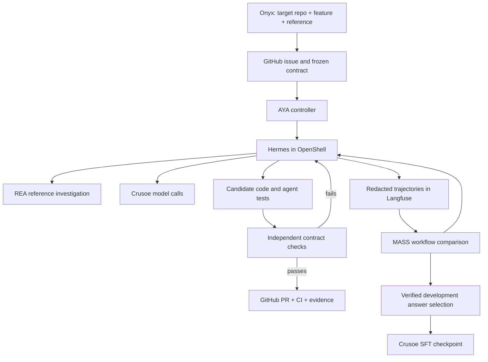

# Architecture

AYA separates a product change from the experiment that evaluates the agent building it.

## Product iteration

1. Freeze the target repository, source reference revision, input/output contract, and independent evaluation definition.
2. Ask native Hermes to inspect the reference using REA and bounded execution. REA process capture supports source behavior investigation; Ghidra supports the separate binary example.
3. Produce code and agent-authored tests inside the worker. Preserve failed checks and repairs.
4. Execute controller-owned checks against the candidate. The tests generated by the agent are additional evidence, not the approval gate.
5. Publish the implementation, provenance, tests, and CI in a pull request. Production integration remains reviewable.

For the SQL component, generated queries run in a separate read-only SQLite executor with no network, host files, or credentials, and bounded execution. This is distinct from the native worker's filesystem policy.

## Workflow iteration

MASS changes the agent workflow while the task, evaluator, and dataset remain fixed. AYA records actual provider calls, tool actions, scores, hashes, and usage in Langfuse. It excludes private reasoning and credentials. Held-out telemetry is metrics-only.

The selector accepts development data only, verifies stored traces through the API, binds them to independent evaluator receipts and source hashes, and ranks comparable answers by correctness. Whole-episode calls, tokens, and latency break ties; they are not invented per-question costs.

The completed public run did not find a stronger native workflow. It selected the cheaper direct baseline's verified answers for a supervised distillation experiment. Training succeeded; deployment and student-versus-base evaluation are still required before any weight-improvement claim.

## Boundaries and remaining work

- The current worker is shared across episodes. Native calls read sibling directories. Per-episode filesystem isolation is not implemented or claimed.
- The evaluator and held-out reference SQL remain host-controlled. Public benchmark memorization cannot be ruled out.
- A future-only staging fix writes the precise public inputs and minimal output contract into each episode directory with hashes. This fixes missing input files; it does not create a filesystem security boundary.
- The next isolation step is a fresh OpenShell sandbox and fresh Hermes state volume per episode, with only approved inputs and explicit development artifacts transferred.
- A source hash binds evaluation to a candidate. A new source change requires evaluation again.
- The current live demo is a configured local development environment, not a hosted multi-tenant service.

The differentiation is the measurable delivery protocol and evidence record. Ordinary coding assistants can implement the same protocol; this experiment does not establish that AYA is generally superior to them.
